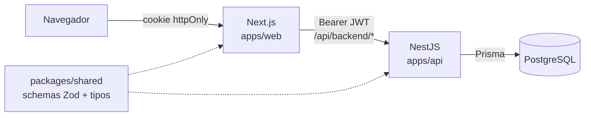

# Admin Panel e-commerce

Panel administrativo genérico y reutilizable para cualquier e-commerce. Esta demo usa la marca ficticia **Tennis Star** (tienda de calzado), pero el nombre, la moneda y el idioma se cambian por variables de entorno.

> **Demo online:** https://syroxtech-prueba-tecnica.vercel.app
> **API + Swagger:** https://admin-panel-api-8fq4.onrender.com/api/docs
> **Usuario de prueba:** `admin@demo.com` / `demo1234`

## Qué incluye

| Módulo | Funcionalidad |
| --- | --- |
| **Login** | Inicio de sesión con JWT guardado en cookie `httpOnly`, opción "Mantener sesión iniciada" y redirección automática si la sesión vence. |
| **Inicio** | Ingresos, cantidad de ventas, ticket promedio, productos activos, **gráfico de los últimos 30 días** (ingresos o cantidad de ventas por día), ventas recientes, productos más vendidos y ventas por estado. Todo sale de la base de datos. |
| **Categorías** | CRUD completo con subcategorías (padre/hija) que se despliegan en la misma tabla, posición, búsqueda, orden y paginación. No deja crear ciclos ni nombres repetidos en el mismo nivel, y tampoco borrar una categoría que tenga subcategorías o productos. |
| **Productos** | CRUD con la misma estructura, alta y edición en una página propia (como en el diseño), filtros por categoría, marca y estado, imagen por URL con vista previa. Sin stock ni pasarela de pagos, como pide la consigna. |
| **Importar productos** _(extra)_ | Carga masiva desde Excel o CSV en 3 pasos: subir el archivo (con plantilla descargable), **elegir qué columna del archivo corresponde a cada dato** (se propone sola según los encabezados, en cualquier orden) y revisar la validación fila por fila antes de confirmar. Si el SKU ya existe actualiza el producto, puede crear las marcas que falten y entiende precios como `150.000,50` o `$ 1.500`. |
| **Ventas** | Botón **Generar venta**: un formulario con cliente, productos y cantidades que hace el `create` en la base. El total lo calcula la API con los precios guardados. Listado real con filtros, y una vista **Gestionar orden** con el detalle y el cambio de estado (Pendiente → En preparación → Enviado → Completado / Cancelado), que queda registrado en un historial. |
| **Exportar a Excel** _(extra)_ | Productos y ventas, respetando la búsqueda y los filtros aplicados. El Excel de productos tiene las mismas columnas que la importación: se puede exportar, editar y volver a importar (los SKU existentes se actualizan). |
| **Marcas** _(extra)_ | CRUD armado solo con los componentes genéricos, para mostrar lo que cuesta sumar una entidad nueva. |

Además tiene modo oscuro, diseño responsive (menú lateral colapsable y menú deslizable en mobile), documentación de la API con Swagger, tests unitarios y CI con GitHub Actions.

## Stack

- **Backend:** NestJS 12 · Prisma 7 · PostgreSQL 16 · Zod · JWT
- **Frontend:** Next.js 16 (App Router) · React 19 · TailwindCSS 4 · shadcn/ui · TanStack Query · React Hook Form
- **Monorepo:** pnpm workspaces

## Arquitectura



```
apps/
  api/        API REST (NestJS + Prisma)
    prisma/   schema, migraciones y seed con datos de ejemplo
    src/      un módulo por recurso: auth, categories, brands, products, sales, dashboard
  web/        Panel (Next.js)
    src/app/          rutas (login, (panel)/...) y route handlers (login, logout, proxy a la API)
    src/components/   ui (shadcn), data-table, crud, form, layout: todo reutilizable
    src/features/     una carpeta por pantalla: api, columnas, formularios y página
packages/
  shared/     schemas de validación, tipos de respuesta y reglas de negocio compartidas
```

### Decisiones principales

- **Una sola fuente de validación.** Los schemas de Zod viven en `packages/shared` y los usan la API (que valida body, query y params, y genera Swagger con ellos) y el panel (que valida los formularios). Si cambia una regla, cambia en los dos lados.
- **Componentes genéricos para los CRUD.** `DataTable` (paginación, orden y búsqueda en el servidor, más los estados de carga, vacío y error), `FormDialog`, `ConfirmDialog`, `RowActions`, los campos de formulario y los hooks `createResourceApi` / `createResourceHooks` / `useTableState` / `useCrudState`. Cada pantalla solo define sus columnas y sus campos.
- **El token no se expone al navegador.** Next.js actúa como backend-for-frontend: el login guarda el JWT en una cookie `httpOnly`, y `/api/backend/*` lo reenvía a la API. Así no hay token en `localStorage` ni problemas de CORS.
- **Las ventas no dependen del catálogo.** Cada ítem guarda nombre y precio al momento de la venta. Editar o borrar un producto no cambia ventas pasadas, y el total se calcula en el servidor (en centavos, para no tener errores de redondeo).
- **Las ventas no se borran, se cancelan.** El cambio de estado sigue un flujo definido en `SALE_STATUS_TRANSITIONS`, que la API hace cumplir y que el panel usa para mostrar solo las acciones posibles. Si se cancela una venta ya cobrada, queda como reembolsada.
- **Errores claros.** Un filtro global traduce los errores de Prisma (duplicados, relaciones, registros inexistentes) a 404/409 con mensajes en español, y los formularios muestran los errores de la API debajo de cada campo.

## Cómo levantarlo en local

Requisitos: **Node 22+**, **pnpm 10** (`corepack enable`) y **Docker** (o un PostgreSQL propio).

```bash
pnpm install
pnpm db:up                                   # PostgreSQL en Docker (puerto 5433)
cp apps/api/.env.example apps/api/.env       # en Windows: copy apps\api\.env.example apps\api\.env
cp apps/web/.env.example apps/web/.env.local
pnpm db:migrate                              # crea las tablas
pnpm db:seed                                 # carga la demo (usuario, categorías, productos, ventas)
pnpm dev                                     # API en :3001 y panel en :3000
```

Después entrar a http://localhost:3000 con `admin@demo.com` / `demo1234`. La documentación de la API queda en http://localhost:3001/api/docs.

### Scripts útiles

| Comando | Qué hace |
| --- | --- |
| `pnpm dev` | Levanta API, panel y `shared` en modo watch |
| `pnpm build` | Compila todo |
| `pnpm test` | Tests unitarios de la API (Vitest) |
| `pnpm lint` | Lint de API y panel |
| `pnpm db:reset-demo` | Borra todo y vuelve a cargar los datos de ejemplo |

### Variables de entorno

**API (`apps/api/.env`)**

| Variable | Descripción |
| --- | --- |
| `DATABASE_URL` | Conexión a PostgreSQL |
| `JWT_SECRET` | Clave para firmar los tokens (mínimo 32 caracteres) |
| `PORT` | Puerto de la API (3001 por defecto) |
| `CORS_ORIGINS` | Orígenes permitidos, separados por coma |

**Panel (`apps/web/.env.local`)**

| Variable | Descripción |
| --- | --- |
| `API_URL` | URL de la API (solo la usa el servidor de Next) |
| `NEXT_PUBLIC_STORE_NAME` | Nombre de la tienda |
| `NEXT_PUBLIC_LOCALE` / `NEXT_PUBLIC_CURRENCY` | Formato de números y moneda (`es-AR` / `ARS` por defecto) |
| `NEXT_PUBLIC_SHOW_DEMO_CREDENTIALS` | Muestra el usuario de prueba en el login |

## Deploy

- **Base de datos y API → Render.** El archivo `render.yaml` crea las dos cosas (New → Blueprint). En cada deploy la API aplica las migraciones y carga la demo solo si la base está vacía.
- **Panel → Vercel.** Root directory `apps/web` y la variable `API_URL` apuntando a la URL de Render.

> En el plan gratuito de Render la API se duerme después de 15 minutos sin uso: el primer request puede tardar alrededor de un minuto.

## Tests

```bash
pnpm test
```

Cubren las reglas de negocio más importantes: cálculo del total con precios de la base, rechazo de productos inexistentes o inactivos, flujo de estados de una venta, reembolso al cancelar; en categorías la prevención de ciclos, los nombres duplicados y el bloqueo de borrado; y en la importación la lectura de precios, la búsqueda de categorías por nombre o ruta y la detección automática de columnas.

## Posibles mejoras

- Roles y permisos (admin / vendedor) y gestión de usuarios.
- Subida de imágenes a un storage (S3 / Cloudinary) en lugar de URLs.
- Variantes de producto (talle, color) como en el diseño de referencia.
- Tests end-to-end (Playwright) dentro del CI.

---

Desarrollado por **Juan Sebastián Stagno** · [LinkedIn](https://linkedin.com/in/juan-stagno) · [GitHub](https://github.com/jsstagno90) · jsstagno@hotmail.com
